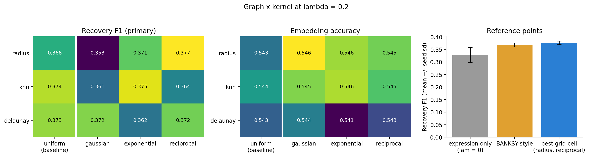
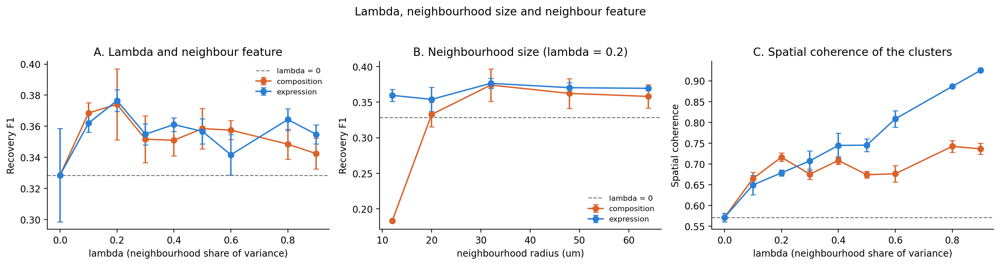
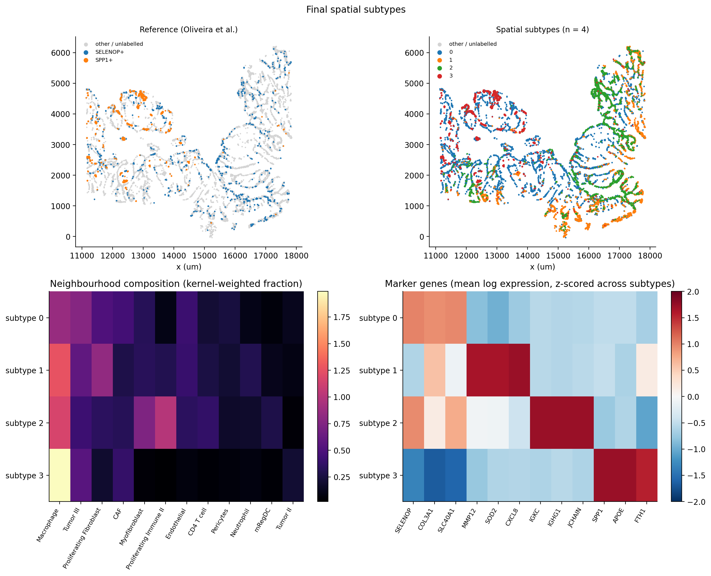

# spatialsubtypes: Spatially Informed Cell Subtyping

This package finds subtypes of one cell type in spatial transcriptomics data by combining each cell's own expression with its surroundings, combining:
- **Spatial neighbour graphs** (fixed radius, k-nearest neighbours, Delaunay triangulation)
- **Distance-decay kernels** (Gaussian, exponential, reciprocal 1/d, and a uniform baseline)
- **BANKSY-style neighbour-augmented embedding** that mixes own and neighbourhood features with a single weight $\lambda$
- **Leiden clustering** with a resolution search that reaches a requested cluster count
- **Pairwise validation** that merges clusters which are neither spatially coherent nor transcriptionally distinct

It works on any platform that provides expression and coordinates in an `AnnData` object (Visium HD, Xenium, MERFISH, CosMx). It was developed and tested on macrophages in a Visium HD colorectal cancer sample.

## Biology Background

### What does this tool do?

A cell type is rarely uniform. Macrophages at the edge of a tumour, for example, split into states such as SPP1+ and SELENOP+ that sit in different tissue niches. Clustering on a cell's own expression alone can blur such states, because part of a cell's identity is shaped by where it sits. Spatial platforms record both expression and position, so the surroundings can be used as additional evidence.

This tool takes the cells of one type and:
1. **Builds a neighbourhood** for each cell from all cells in the tissue
2. **Weights neighbours by distance**, so closer cells count more
3. **Combines own and neighbourhood expression** into one embedding, with $\lambda$ setting the balance
4. **Clusters the embedding** into candidate subtypes
5. **Validates each pair of neighbouring clusters** and merges those that fail

### Key Concepts

- **Visium HD bin**: A square capture area (8 µm here) that reads the transcripts under it; roughly cell-sized but not always exactly one cell
- **Neighbourhood expression**: The weighted average expression of the cells around a cell, a summary of its microenvironment
- **Neighbour-augmented embedding**: Concatenating a cell's own features with its neighbourhood features before dimensionality reduction (the idea behind BANKSY)
- **Distance decay**: A rule that gives nearer neighbours more weight than farther ones
- **Spatial coherence**: The tendency of cells with the same label to sit next to each other
- **Cell-type composition**: The fractions of each cell type around a cell, an alternative neighbourhood summary to mean expression

## Parameters 

### Neighbour Graphs

For each target cell $i$, a neighbour set $\mathcal{N}(i)$ is drawn from every cell in the tissue (not only the target type):

- **Radius**: all cells within distance $r$ (32 µm gives about 48 cells on the 8 µm grid)
- **kNN**: the $k$ closest cells (default $k = 48$)
- **Delaunay**: cells connected by the triangulation, expanded over several hops (3 rings). Edges longer than 3 times the median edge length are pruned so the triangulation does not bridge gaps in the tissue.

Every edge stores its true Euclidean length $d_{ij}$.

### Distance-Decay Kernels

Weights are normalised so each row sums to 1: $w_{ij} = \tilde{w}_{ij} / \sum_{j'} \tilde{w}_{ij'}$. With bandwidth $h$ (the radius for radius graphs, otherwise the distance to the farthest neighbour):

| Kernel | Unnormalised weight $\tilde{w}_{ij}$ |
|---|---|
| Gaussian | $\exp(-2 d_{ij}^2 / h^2)$ |
| Exponential | $\exp(-2 d_{ij} / h)$ |
| Reciprocal (BANKSY's $1/d$) | $1 / \max(d_{ij}, d_{min})$ |
| Uniform (baseline) | $1$ |

### Features

Let $X$ be the log-normalised expression and $\sigma_g$ the tissue-wide standard deviation of gene $g$.

- **Own block** $A$: the target cells' highly variable genes (default 2000), z-scored and divided by $\sqrt{G}$ so its total variance is 1
- **Neighbour block** $N = W\,(X/\sigma)$, centred and divided by $\sqrt{G}$, where $W$ is the kernel weight matrix. Averaging shrinks its variance below 1.
- **Composition option**: $X/\sigma$ is replaced by standardised cell-type indicators, so $N$ holds the weighted fraction of each cell type

$$Z = \mathrm{PCA}\left(\left[\sqrt{1-\lambda}\,A \;\; \sqrt{\lambda}\,N\right]\right)$$

$\lambda = 0$ uses own expression only. Cells with no neighbours receive the average neighbourhood, never their own expression.

### Clustering

A kNN graph (15 neighbours) is built on the first 50 principal components and partitioned with Leiden. The resolution is searched on a log scale by bisection until the partition has the requested number of clusters.

### Validation of Subtypes

Each cluster is compared with its nearest sibling (nearest centroid in the own-expression embedding) and kept only if both tests pass:

1. **Spatial test.** On a symmetric kNN graph among target cells only ($k = 10$), a one-sided permutation test (1000 permutations, Benjamini-Hochberg corrected, $\alpha = 0.05$) asks whether the cluster's cells are joined to each other more than expected by chance.
2. **Expression test.** A cross-validated logistic regression must separate the cluster from its sibling using own expression, with mean AUC $\geq 0.8$.

Clusters under 20 cells fail automatically. The smallest failing cluster is merged into its sibling and the tests repeat. No cell is dropped.

## Model Aspects

### Settings Compared

| Choice | Options |
|---|---|
| Graph | radius, kNN, Delaunay |
| Weighting | Gaussian, exponential, reciprocal, uniform baseline |
| Neighbour feature | mean expression (default), cell-type composition |
| $\lambda$ | 0.0 to 0.9 |
| Neighbourhood size | radius 12, 20, 32, 48, 64 µm |

A **BANKSY-style reference** (kNN 15, Gaussian, $\lambda = 0.2$) was run inside the same framework. 

### Expected Data Format

An `.h5ad` file with:

- `adata.X`: log-normalised expression
- `adata.obsm["spatial"]` (or another key): an $n \times 2$ array of coordinates, in the same units as `radius`
- `adata.obs[cell_type_key]`: cell-type label per cell (missing labels allowed)

The test dataset (Visium HD, patient P2CRC, 8 µm bins) used `obsm["spatial_um"]` and `obs["DeconvolutionLabel1"]`; the 14,628 target bins were macrophages within 50 µm of tumour.

## Installation

### Requirements
- Python 3.9+
- numpy, scipy, pandas, scikit-learn, anndata, igraph, leidenalg (installed automatically)

### Setup

```bash
git clone https://github.com/heitor-sg5/spatial_subtypes 
cd spatial_subtyping
pip install -e .
```


## Usage

### Running the Pipeline

```python
import anndata as ad
from spatialsubtypes import find_spatial_subtypes

adata = ad.read_h5ad("data/VisiumHD_P2CRC_8um_Annotated.h5ad")

result = find_spatial_subtypes(
    adata,
    cell_type_key="DeconvolutionLabel1",   # column in adata.obs
    target_type="Macrophage",              # the cell type to subdivide
    spatial_key="spatial_um",              # key in adata.obsm
    mode="radius", radius=32.0,            # neighbourhood: 32 µm radius
    kernel="reciprocal",                   # distance weighting
    lam=0.2,                               # neighbourhood share of the embedding
    n_clusters=8,                          # start from 8; validation merges the surplus
)

adata.obs["spatial_subtype_validated"].value_counts()
result.stats     # one row per cluster: size, sibling, p-value, AUC, pass/fail
result.merges    # which clusters were merged, and why
```

Pass `target_mask=` (a boolean array) instead of `cell_type_key` and `target_type` to select cells any other way. Use `neighbour_feature="composition"` with `composition_key=` for the cell-type composition option.

### Input

#### Configuration Parameters

- **mode**: `radius`, `knn` or `delaunay`
- **radius / n_neighbors / rings**: neighbourhood size for the chosen graph
- **kernel**: `gaussian`, `exponential`, `reciprocal` or `uniform`
- **lam**: weight of the neighbourhood, 0 to 1
- **neighbour_feature**: `expression` or `composition`
- **n_clusters or resolution**: target cluster count, or a fixed Leiden resolution
- **validate**: turn validation on or off
- **seed**: random seed for reproducibility

### Output

1. **`adata.obs["spatial_subtype"]`**: raw Leiden clusters (`"NA"` outside the target cells)
2. **`adata.obs["spatial_subtype_validated"]`**: clusters after validation
3. **`SubtypeResult.stats`**: per-cluster size, nearest sibling, spatial statistic, p-values, AUC and pass/fail
4. **`SubtypeResult.merges`**: every merge made, with its reason

### Choosing Neighbourhood Size

Keep graphs comparable by matching the number of neighbours rather than the parameter. On Visium HD's 8 µm grid, a 32 µm radius, 48 nearest neighbours and 3 Delaunay rings all give roughly 36 to 48 neighbours.

## Project Structure

```
spatial_subtyping/
├── src/spatialsubtypes/
│   ├── graph.py        # radius, kNN and Delaunay graphs; distance-decay kernels
│   ├── features.py     # gene selection, own and neighbour blocks, lambda mixing
│   ├── cluster.py      # Leiden clustering and resolution search
│   ├── validate.py     # pairwise spatial and expression validation
│   └── pipeline.py     # find_spatial_subtypes entry point
├── figures/            # the three result figures shown below
└── pyproject.toml
```

## Results and Discussion

The figures were produced with local benchmark scripts on the P2CRC Visium HD sample. The 14,628 target bins (macrophages within 50 µm of tumour) include 935 SPP1+ and 858 SELENOP+ bins from Oliveira et al.; the remaining 12,835 carry no subtype name. Scores use these labels as three groups (SPP1+, SELENOP+, other):

- **Recovery F1** (primary): for each named subtype, the best F1 that any single cluster reaches over all target bins, averaged over the two subtypes, then over cluster counts of 4, 6, 8 and 10 and 5 Leiden seeds
- **Embedding accuracy**: cross-validated balanced accuracy of a kNN classifier predicting the three groups from the embedding
- **Spatial coherence**: the share of graph edges between target cells whose two ends carry the same label
- **Pair ARI**: adjusted Rand index restricted to the named bins

Error bars are the standard deviation over the 5 seeds.

### Which graph and weighting?



**Figure 1. Graph and weighting comparison.** Left and middle: recovery F1 and embedding accuracy for each graph (radius 32 µm, kNN with $k = 48$, Delaunay with 3 rings) and weighting, at $\lambda = 0.2$ with mean expression as the neighbour feature. Uniform weights are the baseline. Right: recovery F1 of expression only ($\lambda = 0$, 0.329 ± 0.030), the BANKSY-style reference (kNN 15, Gaussian, $\lambda = 0.2$; 0.368 ± 0.008) and the best grid cell (radius with reciprocal weights; 0.377 ± 0.007). Error bars are the seed standard deviation.

All 12 graph and weighting combinations scored 0.353 to 0.377, and the best cell (radius, reciprocal) led the runner-up (kNN, exponential, 0.375) by only 0.001, far below the seed spread of 0.007 to 0.023. The uniform baseline performed like the distance-weighted kernels, so distance decay added nothing measurable here, and the BANKSY-style configuration was indistinguishable from the best cell. On this dataset **no graph or kernel can be called better**. All of them improved on expression alone: pair ARI rose from 0.32 to 0.46-0.51, spatial coherence from 0.57 to about 0.65-0.70 and embedding accuracy from 0.52 to 0.54-0.55. Recovery F1 rose by 0.03 to 0.05, which is small next to the $\lambda = 0$ spread of 0.030.

### How much neighbourhood?



**Figure 2. Neighbourhood weight, size and feature.** (A) Recovery F1 against $\lambda$ for the neighbour feature mean expression (blue) and cell-type composition (orange), using a radius of 32 µm and reciprocal weights. The dashed line is $\lambda = 0$. (B) Recovery F1 against neighbourhood radius at $\lambda = 0.2$ (about 8, 20, 48, 112 and 195 neighbours for 12, 20, 32, 48 and 64 µm). (C) Spatial coherence of the clusters against $\lambda$. Error bars are the seed standard deviation.

- **$\lambda$ saturates early.** Recovery F1 peaks at $\lambda = 0.2$ (0.377) and stays within noise of 0.34-0.36 from 0.1 to 0.9. Larger $\lambda$ mainly raises spatial coherence (0.68 to 0.93), which means smoother clusters, not closer agreement with the reference labels.
- **Mean expression is at least as good as composition.** Composition matches it on recovery F1 at $\lambda \leq 0.2$ but its pair ARI is clearly lower at every $\lambda \geq 0.3$.
- **Neighbourhood size matters little.** All radii fall within 0.02 of each other, with 32 µm nominally best (0.377).

A reasonable default is therefore about 48 neighbours (radius or kNN) with $\lambda$ between 0.1 and 0.2. That is a sensible starting point, not a demonstrated optimum.

### What do the final subtypes look like?



**Figure 3. Final spatial subtypes** (radius 32 µm, reciprocal kernel, $\lambda = 0.2$, mean expression, 8 starting clusters merged by validation to 4). Top left: reference SPP1+ (orange) and SELENOP+ (blue) macrophages from Oliveira et al.; all other target bins are grey. Top right: the four validated subtypes on the tissue. Bottom left: kernel-weighted cell-type composition around each subtype (the 12 most common types). Bottom right: mean log expression of the top three marker genes per subtype, plus SPP1 and SELENOP, z-scored across subtypes.

Validation reduced 8 raw clusters to 4 subtypes, raising spatial coherence from 0.575 to 0.695 while keeping recovery F1 (0.366 to 0.370) and raising pair ARI (0.433 to 0.479). Subtype 3 holds 828 of the 935 SPP1+ bins (47% precision). It has the highest SPP1, APOE and FTH1 expression and the most macrophage-dense surroundings, and it coincides with the SPP1+ cluster in the upper left of the tissue. The SELENOP+ macrophages are **not** recovered as a subtype: its best cluster (subtype 0) is only 7% SELENOP+ against a 5.9% overall rate, so the recovery F1 of 0.370 comes almost entirely from SPP1+ (about 0.61, against about 0.13 for SELENOP+). Subtype 1 is marked by MMP12, SOD2 and CXCL8, and subtype 2 by immunoglobulin genes (IGKC, IGHG1, JCHAIN) with plasma-cell-like neighbours; the immunoglobulin signal could reflect neighbouring plasma cells or ambient RNA in the 8 µm bins rather than a macrophage state, and this was not tested.

### Summary

- Neighbour-augmented embeddings improve agreement with the published subtypes over expression alone, by a small margin in recovery F1 and a clearer one in pair ARI and spatial coherence.
- The choice of graph, weighting, neighbourhood size and, above $\lambda \approx 0.1$, $\lambda$ made no measurable difference. Mean expression was at least as good as cell-type composition.
- The BANKSY-style configuration performed the same as the best configuration found, so no advantage over BANKSY is claimed.

## Limitations

- The reference subtypes come from expression-based clustering, which favours methods that rely on a cell's own expression, and only 1,793 of the 14,628 bins carry a subtype name. Scores against them therefore say little about whether the spatial neighbourhood helps.
- It is not established whether the improvement over expression alone comes from spatial information or from the generic smoothing that any neighbour averaging provides.
- Absolute recovery is low (F1 about 0.38) and SELENOP+ was not recovered.
- Results are from one tissue section; the seed spread reflects clustering randomness only, so differences below about 0.02 should not be interpreted.

## References

- Singhal V. et al. BANKSY unifies cell typing and tissue domain segmentation for scalable spatial omics data analysis. *Nature Genetics* 56, 431–441 (2024). https://doi.org/10.1038/s41588-024-01664-3 (code: https://github.com/prabhakarlab/Banksy_py)
- Oliveira M. F. et al. High-definition spatial transcriptomic profiling of immune cell populations in colorectal cancer. *Nature Genetics* 57, 1512–1523 (2025). https://doi.org/10.1038/s41588-025-02193-3 (code and dataset: https://github.com/10XGenomics/HumanColonCancer_VisiumHD)

## AI Assistance Disclosure

This project was developed with the assistance of Claude (Anthropic). Claude helped build and debug the unit tests and benchmark scripts used to validate the tool and generate the figures above. The original idea, src/ code, the choice of data and comparisons, and the review and interpretation of results are my own. 
